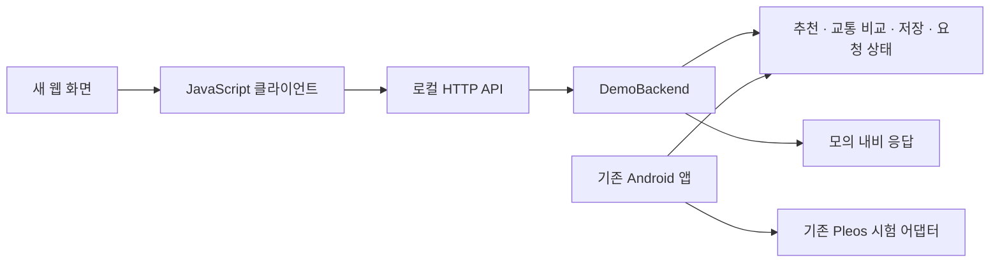

# 새 화면 연결 계약 · v2

작성일: 2026-11-05. API schemaVersion은 `1.0`이다. 기존 04 프로토타입은 보존하고 이 버전에서 날짜 수정과 화면 연결 계층을 추가했다.

## 바로 연결하기

1. 프로젝트 루트의 `START_BACKEND.cmd`를 실행한다. 기본 주소는 `http://127.0.0.1:8791`이다.
2. 콘솔에 표시된 새 실행 폴더의 `connection.json`에서 `baseUrl`, `token`을 읽어 개발 설정으로 전달한다. 토큰은 실행마다 바뀌며 소스·공유 문서·프런트 배포물에 넣지 않는다.
3. 새 화면에서 `client/routine-client.mjs`를 import한다. TypeScript 선언은 같은 위치의 `routine-client.d.mts`다.
4. `getState()`로 처음 상태를 읽고, 사용자 행동마다 명령을 한 번 보내 반환 상태로 화면을 갱신한다. 동시에 여러 변경 명령을 보내지 않도록 버튼을 잠근다.

기본 허용 화면 주소는 `http://localhost:5173`, `http://127.0.0.1:5173` 두 개다. 다른 개발 포트라면 `START_BACKEND.ps1 -Origin 'http://localhost:3000'`처럼 정확한 주소를 지정한다. 주소 추가는 반복 인자를 받는 Java CLI 또는 PowerShell 문자열 배열로 설정한다. file:// 화면과 외부 사이트는 연결 대상이 아니다.

```javascript
import { createRoutineClient, RoutineApiError } from "./routine-client.mjs";

// connection은 개발 환경에서 로컬 connection.json을 읽어 전달한 값.
const api = createRoutineClient(connection);
let state = await api.getState();

// 아래는 예시 이력을 사용하는 개발용 시연 준비 순서.
await api.setContext(Date.parse("2026-11-04T08:00:00+09:00"), "Asia/Seoul");
await api.setConsent(true);
await api.seedDemo();
state = await api.recommend(true);
await api.setDemoScenario({ traffic: "CONGESTED" });
state = await api.refreshTraffic(); // 44분, 과거 중앙값 29분, 차이 15분

// 실제 UI에서는 확인 버튼을 누를 때만 실행.
if (state.navigation.canConfirm) {
  try {
    state = await api.confirm();
  } catch (error) {
    if (error instanceof RoutineApiError && error.uncertainMutation) {
      // 응답만 유실됐을 수 있다. confirm을 재전송하지 않고 상태를 조회한다.
      state = await api.getState();
    } else {
      throw error;
    }
  }
}
```

개발용 예시 이력 주입과 수집 동의는 사용자용 시작 흐름에서 자동 실행하지 않는다. UI의 실제 확인·거절·동의 이벤트에 맞춰 각각 연결한다. 서버는 시연 시각을 자동으로 진행시키지 않으며 `setContext`를 호출할 때만 바뀐다.

## API와 상태

| 요청 | 계약 |
|---|---|
| GET /v1/state | 읽기 전용. 안내 요청·추천·기록·시각 변경 없음 |
| POST /v1/commands | UTF-8 application/x-www-form-urlencoded, operation 필드와 명령 인자 |
| X-Routine-Token | GET/POST 모두 필수, connection.json의 현재 토큰 |
| 성공 응답 | BackendSnapshot JSON, schemaVersion=1.0, mode=DEMO |
| 오류 응답 | schemaVersion + error.code + error.message |
| HTTP 코드 | 입력 오류 400, 토큰 401, 주소 403, 상태 충돌 409, 본문 크기 413, 본문 형식 415, 저장/서버 오류 500 |

POST 본문은 JSON이 아니다. 클라이언트가 URLSearchParams로 인코딩한다. 중복 필드·잘못된 UTF-8·알 수 없는 인자를 거절하며 본문은 8 KiB까지 받는다. `OPTIONS`는 허용된 Origin의 사전 요청을 처리한다.

명령별 필수 인자와 상태 변경은 [Java 서비스 계약](../core/src/main/java/kr/routine/presentation/README.md)에 있다. 아래 필드가 화면의 판단 기준이다.

| 필드 | 화면에서의 의미 |
|---|---|
| context | epoch milliseconds, IANA 시간대, 현지 날짜, 월요일=1인 요일, 자정부터 분 |
| destinations | 현재 선택 가능한 목적지. id와 subId를 함께 전달 |
| recommendation | 근거·표본 날짜 수·추천 목적지. samples는 확률이나 정확도가 아님 |
| recommendation.holdType/candidates | BR-17의 보류 유형 NONE/NOT_ENOUGH/TIE와 동률 후보·후보별 선택 날짜 수 |
| traffic | 예상 분·비교 기준 분·차이. 알 수 없는 수치는 null |
| traffic.kind/history | 교통 상태 코드와 비교에 사용한 날짜별 기록. 동의 해제 시 목록·중앙값·차이를 비움 |
| navigation.canConfirm | 확인 버튼 허용 여부의 최종 기준 |
| navigation.activeRoute | 현재 안내 상태. ACTIVE(활성), INACTIVE(비활성), UNAVAILABLE(조회 불가). 이전 v2 서버에서는 필드가 생략될 수 있다. |
| navigation.state/code | READY, VERIFIED, UNCONFIRMED 등. 문구를 파싱해 상태를 추정하지 않음 |
| counts.navigationRequests | 현재 프로세스의 모의 안내 요청 횟수 |
| notice | 안내 결과와 별개인 저장 문제 등. null이면 별도 문제 없음 |
| capabilities | liveNavigation/mapGeometry/etaPerPreference 모두 false |

`VERIFIED`는 **모의 안내 응답을 확인했다는 뜻**이다. 실제 차량에서 안내를 시작했다는 뜻으로 보여 주지 않는다. 교통 값 역시 모의 입력이며, 지도 경로 도형이나 경로 성향별 ETA는 제공하지 않는다. 모의 여부와 정보 없음은 사용자에게 이해되는 문구로 표시하고 내부 클래스명·상태 코드까지 화면에 나열할 필요는 없다.

`confirm` 이후에는 결과가 불확실해도 같은 이동을 재요청하지 않는다. `newDemoTrip`은 시연을 다시 하기 위한 명시적 초기화이며 실차 복구 기능이 아니다. 클라이언트는 자동 재시도하지 않는다. 타임아웃·통신 단절·서버 오류의 `uncertainMutation=true`에서는 상태를 먼저 조회한다. 상태 조회도 실패하면 연결 문제를 표시하고 자동 확정을 중단한다.

## 저장과 경계

기본 저장 파일은 `demo-data/bridge.properties`다. PC Swing 데모의 저장소와 분리했다. 초기 수집 동의는 꺼져 있고, 설정과 직접 등록한 규칙은 별도로 저장한다. `clearHistory`는 선택·교통 기록만 비운다. 실행 중 다른 도구가 저장 파일을 바꾸면 기존 파일을 덮어쓰지 않고 저장 오류를 반환한다.

수집 해제 저장에 실패하면 이번 실행의 수집과 새 안내 요청을 차단한다. 디스크에는 이전 값이 남을 수 있으므로 재시작 전 저장 문제를 해결하고 해제 상태를 확인해야 한다.

이 연결은 같은 PC의 로컬 개발·시연용이다. 휴대폰 동기화, 외부 서버, 실제 Pleos 안내·지도, 상시 패턴 수집은 포함하지 않는다. native Android는 기존 Java core/플랫폼 연결을 계속 사용하며 이 HTTP 서버를 차량 안에서 띄우지 않는다.



응답 예시는 `examples`의 JSON 파일에 있다. 실제 클라이언트 통합 시험에서 얻은 모의 상태이며 연결 토큰은 포함하지 않는다. [BR-17·BR-16의 다섯 상태 재현과 동의 처리](BR17_BR16_STATES_AND_HISTORY.md)를 함께 참고한다. 새 필드가 없는 이전 서버에서는 관련 화면을 미지원으로 표시하고 메시지를 파싱하지 않는다.

**BR-05 연결** 앱을 열거나 화면으로 돌아왔을 때 `await api.refreshActiveRoute()`로 현재 경로를 조회한다. 새 안내 발행은 0회다. 단순 화면 갱신은 `getState()`를 쓴다. 활성은 “이미 안내 중”, 조회 불가는 “현재 경로를 확인할 수 없어요”로 표시한다. 두 경우 모두 시작 버튼을 잠근다. 사용자가 상태를 다시 확인한 뒤 비활성·정차·목적지 준비 조건이 충족될 때만 새 확인을 받는다. 개발 패널은 `api.setDemoScenario({ activeRoute: "ACTIVE" })`처럼 세 값을 재현할 수 있다. [세 상태의 발행 횟수와 오류 코드](BR05_ACTIVE_ROUTE.md)

