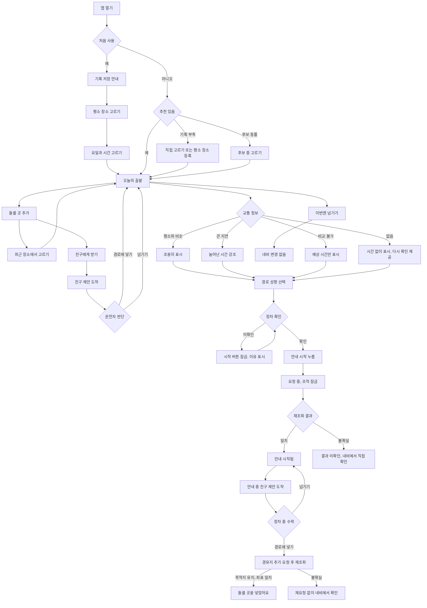

# 기획과 사용자 흐름

작성 2026-11-05. 제품 이름은 `늘길`이다. 인터뷰 전 단계라 대상과 문제는 가설이다.

## 1. 한 줄 정의

타면 이미 오늘의 경로가 돼 있는 차량용 앱. `여기 들러`에서 시작한 "지점을 말로 설명하고 다시 찾는 수고를 없앤다"는 생각을 매일의 이동까지 넓혔다.

## 2. 대상과 문제

| 구분 | 내용 | 근거 수준 |
|---|---|---|
| 대상 | 같은 요일·시간대에 반복 이동하고, 가끔 가족이나 친구를 태우거나 들를 곳이 생기는 운전자 | 가설 |
| 문제 1 | 경로를 만들려면 매번 목적지를 찾고 조건을 고른다 | 가설. 터치 수 비교 필요 |
| 문제 2 | 들를 곳이 생기면 말로 설명을 듣고 차에서 다시 검색한다. 이름이 비슷한 입구는 틀리기 쉽다 | 2024년 운전자 후기 한 건 수준. 인터뷰 필요 |
| 문제 3 | 익숙한 길이라 내비를 켜지 않고 출발했다가 평소와 다른 지연을 늦게 안다 | 가설 |

기존 대안은 내비 없이 출발하기, 카카오내비의 목적지 추천과 실시간 도착시간, 마이현대 목적지 전송, 순정 내비, Gleo 음성 안내다. 목적지 추천과 교통 반영, 음성 경유지 추가는 이미 있는 기능이라 각각만으로는 차별점이 되지 않는다.

## 3. 차별 가치 가설

**흩어진 수고를 경로 하나로 묶는다.** 내 일상이 목적지를 정하고, 함께하는 사람이 들를 곳을 보태고, 오늘의 교통이 판단을 돕는다. 운전자는 준비된 경로를 확인하고 한 번 누른다. 평소와 비슷하면 조용히 넘어가고, 달라진 날에만 알린다.

| 약속하는 것 | 약속하지 않는 것 |
|---|---|
| 반복 이동의 선택 부담을 줄인다 | 더 빠른 도착, 정체 회피 |
| 평소와 다른 지연을 출발 전에 보여 준다 | 지연 원인, 예측 정확도 |
| 운전자가 확인해야만 안내를 요청한다 | 자동 출발, 자동 경로 변경 |
| 저장을 허용한 선택만 기기 안에 남긴다 | 전체 운행 이력 학습 |
| 순정 내비의 경로 성향을 전달한다 | 피로 감소, 쾌적함, 안전 개선 |

## 4. 차량에서 해야 하는 이유

- 출발 직전, 차 안에서 판단이 일어난다. 휴대폰을 꺼내지 않고 정차 상태에서 끝낼 수 있다.
- 순정 내비로 바로 이어진다.
- 정차 상태와 주행 제한을 앱 흐름에 반영한다.

이 항목도 기존 내비 대비 실사용 효용은 미검증이다(R6).

## 5. MVP 범위

| 포함 | 제외 |
|---|---|
| 폰에서 보낸 경로의 탑승 시 자동 시작과 취소(시연은 예시 데이터) | 이번 접수의 실제 폰 앱, 폰의 상세 설정 |
| 직접 등록한 시간대, 앱 안에서 확인한 선택 기반 추천 | 설치 전 전체 운행 학습, 앱 미실행 중 상시 학습 |
| 친구가 보낸 들를 곳을 운전자가 수락해 경로에 넣기(시연은 예시 데이터) | 친구 앱 설치, 자동 경유지 추가, 경유지 2곳 초과 |
| 같은 기준의 과거 예상 시간과 비교 | 자체 경로 계산, 성향별 시간 비교 |
| 순정 경로 성향 3종 선택 | 익숙한 도로 유지 같은 세부 조건 |
| 정차 확인 후 한 번 요청, 재조회 확인 | 자동 재요청, 활성 경로 덮어쓰기 |
| 기기 안 저장, 기록 끄기, 이력 지우기 | 서버, 계정, 휴대폰 연동 |

## 6. 핵심 사용 장면

**기본 장면: 차에서**

1. 차에 타서 앱을 연다. 오늘의 경로가 준비돼 있다.
2. 친구가 보낸 들를 곳이 있으면 `경로에 넣기`를 누른다.
3. `안내 시작`을 누르고 출발한다. 달리는 중 도착한 제안은 정차했을 때 경로를 끊지 않고 넣는다.

**빠른 길: 엘베에서 딸깍**

1. 엘리베이터를 타고 내려오면서 폰에서 `차에 경로 보내기`를 한 번 누른다.
2. 차에 타면 정차를 확인한 뒤 안내가 자동으로 시작된다. 잠깐 동안 취소할 수 있다.
3. 정차를 확인하지 못했거나 이미 안내 중이면 시작하지 않는다.

폰은 없어도 된다. 차량 앱만으로 제품이 완성된다. 폰 화면은 이번 접수에서 시연 화면이며 1차 합격 후 모바일 웹으로 구현한다.

## 6-1. 전체 흐름

## 7. 화면 구성

| 화면 | 역할 | 주요 조작 |
|---|---|---|
| 폰 빠른 길(시연) | 타기 전에 미리 경로 보내기 | 차에 경로 보내기, 넣기, 이번엔 넘기기 |
| 처음 설정 | 저장 범위 설명, 평소 장소와 시간 등록 | 켜고 시작, 지금은 건너뛰기 |
| 오늘의 경로 | 준비된 경로, 시간 판단, 성향, 시작을 한 화면에 | 안내 시작, 이번엔 넘기기, 바꾸기, 들를 곳 추가 |
| 들를 곳 | 친구 초대, 제안 확인, 지도 미리보기 | 경로에 넣기, 넘기기 |
| 장소 고르기 | 순정 최근 목적지·즐겨찾기에서 선택 | 장소 선택 |
| 추천 이유 | 왜 이 장소인지와 지난 기록 | 닫기 |
| 안내 상태 | 요청 중, 시작됨, 미확인 | 내비 열기 |
| 내 일상 | 평소 장소, 기본 성향, 기록 관리 | 기록 끄기, 이력 지우기 |

## 8. 상태별 문구 기준

| 상태 | 운전자에게 보이는 말 | 다음 행동 |
|---|---|---|
| 평소와 비슷 | 평소와 비슷해요 | 안내 시작 |
| 큰 지연 | 평소보다 15분 더 걸려요 | 안내 시작 |
| 비교 기록 부족 | 비교할 기록을 모으는 중이에요 | 안내 시작 |
| 교통 없음 | 교통 정보를 받지 못했어요 | 다시 확인, 교통 없이 안내 시작 |
| 교통 오래됨 | 교통 정보가 오래됐어요 | 다시 확인 |
| 정차 미확인 | 정차를 확인하면 시작할 수 있어요 | 기어 P 확인 |
| 요청 중 | 안내를 요청하고 있어요 | 대기, 조작 잠금 |
| 시작됨 | 안내를 시작했어요 | 내비 보기 |
| 결과 미확인 | 안내가 시작됐는지 확인하지 못했어요 | 내비에서 확인. 다시 요청 없음 |
| 넘김 | 이번 추천을 넘겼어요. 내비는 그대로예요 | 다른 곳 고르기 |
| 이미 안내 중 | 지금 안내 중인 경로가 있어요 | 내비 보기 |
| 폰 보냄 | 차에 보냈어요. 타면 안내가 시작돼요 | 보내기 취소 |
| 폰 차 대기 | 차를 켜면 이어져요 | 보내기 취소 |
| 탑승 자동 시작 | 폰에서 보낸 경로예요. 곧 안내를 시작해요 | 이번엔 취소 |
| 탑승 정차 미확인 | 정차를 확인하면 바로 시작해요 | 대기 |
| 탑승 활성 경로 있음 | 지금 안내 중인 경로를 덮어쓰지 않았어요 | 내비 보기 |
| 제안 도착 | 친구가 들를 곳을 보냈어요 | 보기 |
| 경유지 추가됨 | 들를 곳을 경로에 넣었어요 | 내비 보기 |
| 경유지 미확인 | 들를 곳이 들어갔는지 확인하지 못했어요 | 내비에서 확인. 다시 요청 없음 |
| 경유지 있음 | 이미 들를 곳이 있어요 | 내비에서 직접 바꾸기 |

제품 문구에는 "편의", "최적", "쾌적" 같은 추상적인 표현을 쓰지 않는다. 운전자가 무엇을 안 해도 되는지를 구체적으로 말한다.

## 9. 공모전 심사 기준과 연결

| 항목 | 지금 말할 수 있는 것 | 아직 필요한 것 |
|---|---|---|
| 차량특화성 | 타면 경로가 준비된 차, 순정 내비 연결, 정차 확인, 안내 중 경로를 끊지 않는 들를 곳 추가 | 실제 차량 또는 정상 에뮬레이터 동작 |
| 창의성 | 일상과 동행자의 요청을 경로 하나로 묶고 운전자는 확인만 | 인터뷰로 문제 확인 |
| 기술 활용성 | NaviHelper 선언 기반 구현, core 45건 검사 | R1~R3 실제 시험 |
| 사업성 | 반복 사용 구조 가설 | 대상 분석, MAU·유지율 근거. 임의 수치 금지 |

## 10. 검증 계획

운전자 3~5명에게 최근 "누군가를 중간에 태운 이동"과 "평소보다 늦었던 출근"을 재구성하게 한다. 지점을 어떻게 전달받았는지, 다시 검색했는지, 언제 지연을 알았는지, 내비를 켜지 않은 이유를 묻는다. 이어서 프로토타입과 기존 내비로 같은 상황을 진행해 터치 수와 판단 시간을 비교한다. 시연 화면에 대한 호감만으로 수요가 검증됐다고 쓰지 않는다.
