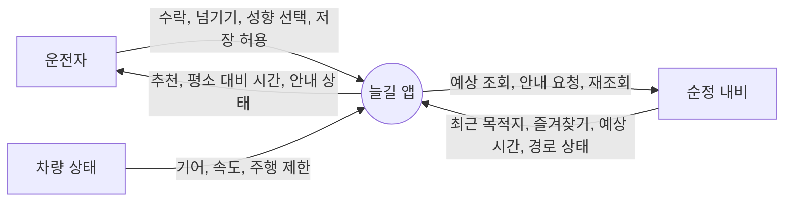
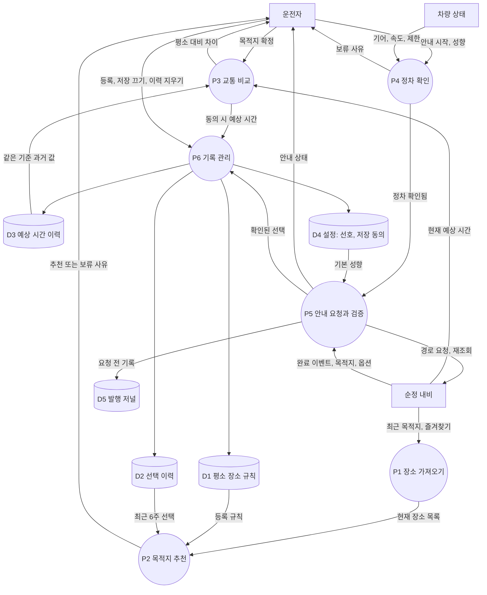
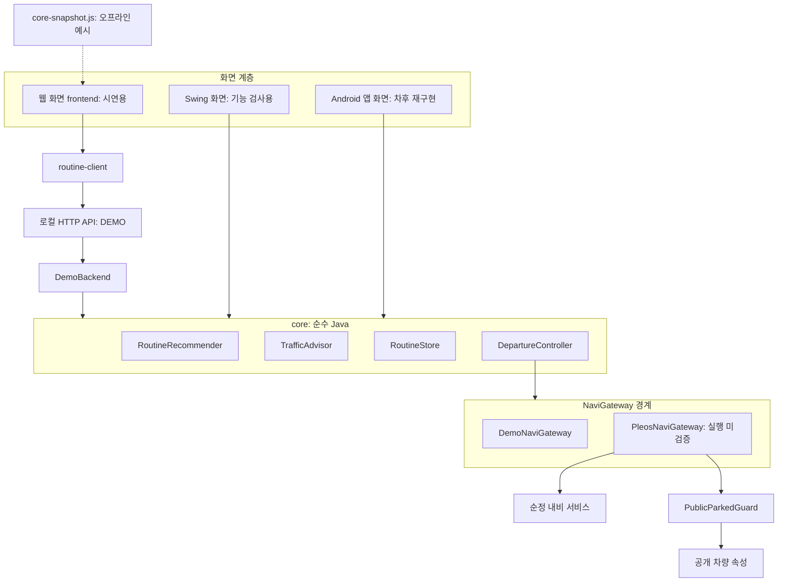
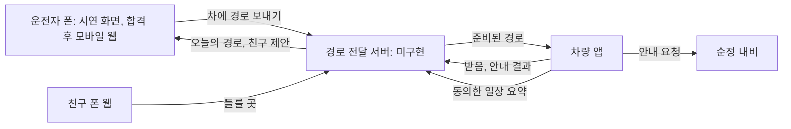
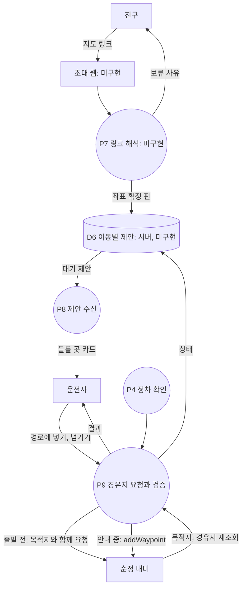

# DFD와 시스템 구조

작성 2026-11-05, 로컬 API 연결 반영. 기준은 `codex/backend-v2`의 현재 코드다. 이 제품은 `여기 들러`의 확장판이지만 들를 곳 기능의 초대 웹, 서버, 경유지 요청은 현재 코드에 없다. 3장은 현재 구현, 8장은 들를 곳까지 포함한 목표 구조다.

## 1. 시스템 경계

앱 하나가 차량 안에서 동작하며 모든 기록은 앱 저장소에 남는다. 외부와의 접점은 순정 내비 서비스와 차량 상태뿐이다.

## 2. DFD Level 0



## 3. DFD Level 1



### 처리와 코드 대응

| 처리 | 현재 구현 | 상태 |
|---|---|---|
| P1 | `NaviGateway.loadDestinations` | 데모 동작. 실제 어댑터 미검증 |
| P2 | `RoutineRecommender` | core 검사 통과 |
| P3 | `NaviGateway.estimate`, `TrafficAdvisor` | core 통과. 실제 ETA는 단위 미확인으로 `minutes=-1` |
| P4 | `NaviGateway.isParked`, `PublicParkedGuard` | 실제 실행 미검증 |
| P5 | `DepartureController`, `PleosNaviGateway` | core 통과. 실제 안내 미검증 |
| P6 | `RoutineStore` | core 검사 통과 |

### 데이터 저장소

| ID | 내용 | 위치 | 비고 |
|---|---|---|---|
| D1 | 장소, 요일, 시각 | 앱 저장소 | 이력 지우기 후에도 유지 |
| D2 | 확인된 선택 최대 200건 | 앱 저장소 | 운행 완료가 아님. 동의해야 저장 |
| D3 | 예상 시간 최대 200건 | 앱 저장소 | 출발 구역, 측정 기준, 모의 여부 포함 |
| D4 | 경로 선호, 저장 동의 | 앱 저장소 | 동의 기본값 꺼짐 |
| D5 | 안내 발행 기록 | 앱 저장소(실제 어댑터) | 재실행 후에도 유지, 재발행 차단 |

## 4. 시스템 구조



웹 화면은 로컬 API를 거쳐 실제 Java core를 호출한다. 이 API는 같은 PC의 개발·시연용이며 차량 안에서 쓰는 구조가 아니다. Android 앱은 HTTP 없이 core를 직접 쓴다. 점선은 백엔드가 없을 때만 쓰는 오프라인 예시다.

## 5. 프로토타입의 데이터 출처

| 화면 요소 | 출처 | 구분 |
|---|---|---|
| 추천 결과, 보류 사유, 표본 일수 | API `recommendation` | core 실행 |
| 평소·예상·차이 시간, 강조 여부 | API `traffic` | core 실행, 입력은 모의 |
| 시작 가능 여부, 안내 상태, 요청 횟수 | API `navigation`, `counts` | core 실행, 응답은 모의 |
| 동의, 선호, 규칙, 이력 | API 명령과 `RoutineStore` | core 실행 |
| 정차 상태 | API `vehicle` | 모의 값 |
| 출발 시 도착 시각 | 시각 + 예상 시간 표시 계산 | 화면 계산 |
| 이미 안내 중, 경로 조회 불가 | API `navigation.activeRoute` | core 실행, 입력은 모의 |
| 보류 유형, 동률 후보, 비교 날짜, 교통 상태 | API `recommendation`, `traffic` | core 실행, 입력은 모의 |
| 들를 곳, 친구 제안, 경유지, 폰 | 화면 시나리오 | 시연 데이터 |
| 목적지 주변 지도 | OpenStreetMap | 실제 지리 자료, 순정 지도 아님 |
| 예시 경로와 출발지 | 도로망 최단거리 계산 | 예시. 순정 경로 아님 |
| 시간 저장, 화면 전환 | 프로토타입 상태 | 시연 전용 |

## 6. Android로 옮길 때의 경계

```text
RoutineScreen (화면)
  └ RoutineUiState (BR-01에서 정의)
      ├ RoutineRecommender
      ├ TrafficAdvisor
      ├ RoutineStore
      └ DepartureController → NaviGateway
```

화면은 `RoutineUiState`만 그린다. 웹 화면이 쓰는 API 스냅샷 `BackendSnapshot`이 이 역할의 기준이다. 시연 화면의 상태 키(`04` 시나리오)와 같은 이름을 쓰면 디자인 검수 항목을 그대로 재사용할 수 있다.

## 7. 계획 요소

아래는 현재 구현이 아니라 제안이다. 들를 곳은 8장에 따로 정리한다.

| 요소 | 조건 |
|---|---|
| 앱 자동 시작, 시동 시 제안 | 공개 API 확인 후 |
| Gleo 음성 연계 | Gleo Interface 가이드 검토 후 |
| 휴대폰 사전 알림 | 차량 앱 검증 뒤 별도 판단 |
| 출발 시각 제안 | 예측 정확도 근거 확보 후 |

## 8. 들를 곳을 포함한 목표 구조

이 장은 구현 전 목표다. 들를 곳의 원래 설계는 `현대차_출품진행_20261104/01_시스템설계.md`에 있다. 프로토타입은 이 흐름을 예시 데이터로 보여 준다.

제품의 중심은 차량 앱이다. 폰은 탑승 전에 미리 보내는 빠른 길이며 없어도 제품이 완성된다. 안내 요청은 차량 앱이 정차를 확인한 뒤 보낸다. 폰에서 보낸 경우 그 입력을 운전자 확인으로 보고 탑승 시 자동 요청하되, 잠깐 취소할 수 있다.



폰이 오늘의 경로를 보여 주려면 추천 결과와 교통 정보가 폰까지 와야 한다. 현재 추천과 기록은 차량 앱 안에만 있고 교통 조회는 순정 내비를 거치므로, 차가 꺼져 있을 때 폰이 무엇을 보여 줄 수 있는지는 미확인이다(BR-08). 시동 후 앱 자동 실행 가능 여부도 미확인이다(BR-15).



| 항목 | 현재 |
|---|---|
| `addWaypoint`, `getWaypointInfo` | SDK 선언 확인. 외부 좌표 등록은 시험 A/B/C 미실행 |
| 출발 전 경유지 포함 요청 | SDK 문서 확인. core의 `NaviGateway.start`에는 경유지 인자가 없음 |
| 초대 웹, 제안 저장소 | 미구현. 차량 위치와 숙소 주소를 서버로 보내지 않는 설계 유지 |
| 제안 상태 | 설계만 있음: PENDING, REQUESTED, ADDED, UNCONFIRMED, FAILED, DISMISSED, EXPIRED |

프로토타입에서 들를 곳 관련 상태는 core 실행 결과가 아니라 화면 시나리오다.
